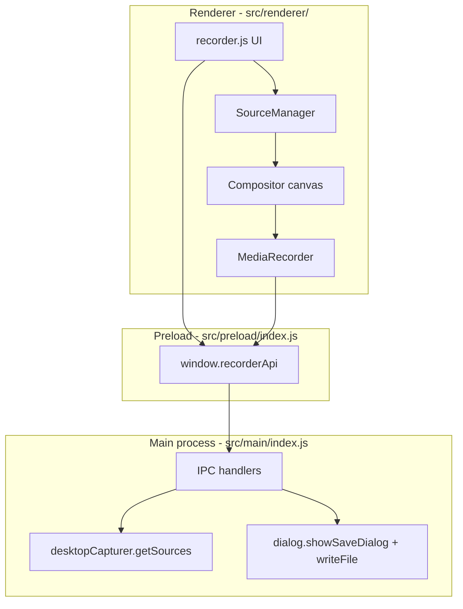

# Developer guide — Video Recorder (Electron)

This document explains **how the desktop app is built**, **how data flows** from screen/camera to a saved `.webm` file, and **how to package it as installable Linux software**. It assumes you know basic JavaScript but are **new to Electron**.

---

## What this app does (one sentence)

The UI runs in a **Chromium window**. It captures screen (and optionally webcam + mic), composites them on a **canvas**, records that canvas with the browser **`MediaRecorder` API**, and saves the file via the **main process** (native save dialog).

---

## Electron in 60 seconds

Electron apps have **three cooperating parts**:

| Part | Folder | Runs in | Can access |
|------|--------|---------|------------|
| **Main** | `src/main/` | Node.js (full OS) | Files, dialogs, `desktopCapturer`, IPC |
| **Preload** | `src/preload/` | Small bridge | `contextBridge` only — exposes safe APIs to the page |
| **Renderer** | `src/renderer/` | Chromium (like a website) | DOM, `getUserMedia`, `MediaRecorder`, canvas |

The renderer **cannot** call Node or read your disk directly. Anything privileged goes through **IPC** (inter-process communication) exposed as `window.recorderApi` in the preload script.

**electron-vite** compiles all three and bundles the renderer with Vite. Output lands in `out/`:

```
out/main/index.js      ← Electron entry (see package.json "main")
out/preload/index.mjs
out/renderer/          ← index.html + JS + CSS
```

---

## High-level architecture



### Typical user flow

1. User picks **layout** (screen only vs screen + webcam).
2. **Main process** lists displays/windows via `desktopCapturer` → renderer fills the dropdown.
3. User clicks **Share & preview** → **SourceManager** starts media tracks (screen, optional camera, mic).
4. **Compositor** draws those tracks onto a 1920×1080 canvas every frame and exposes `canvas.captureStream(30)`.
5. User clicks **Record** → **MediaRecorder** encodes that stream to WebM chunks.
6. User clicks **Stop** → renderer sends the blob to main via IPC → **Save dialog** → file on disk.

---

## Source files (what to read first)

| File | Responsibility |
|------|----------------|
| [`src/main/index.js`](src/main/index.js) | App window, permissions, screen source listing, display-media handler, save recording |
| [`src/preload/index.js`](src/preload/index.js) | `recorderApi`: `getDesktopSources`, `setDisplaySourceId`, `saveRecording` |
| [`src/renderer/recorder.js`](src/renderer/recorder.js) | All UI logic: devices, preview refresh, record/stop |
| [`src/renderer/desktop-sources.js`](src/renderer/desktop-sources.js) | Caches IPC call to list screens/windows |
| [`src/renderer/source-manager.js`](src/renderer/source-manager.js) | Starts/stops camera, screen, mic streams (PipeWire-friendly sequencing on Linux) |
| [`src/renderer/compositor.js`](src/renderer/compositor.js) | Canvas compositor + `captureStream` for recording |
| [`src/renderer/layouts.js`](src/renderer/layouts.js) | Two fixed layouts (layer rects, circle mask on webcam) |
| [`src/renderer/index.html`](src/renderer/index.html) + [`styles.css`](src/renderer/styles.css) | Markup and styling |

There is **no React/Vue** — plain ES modules and DOM APIs keep the mental model small.

---

## IPC API (preload ↔ main)

Defined in preload, implemented in `setupIpc()` in main:

| `window.recorderApi` method | Main handler | Purpose |
|-----------------------------|--------------|---------|
| `getDesktopSources()` | `get-desktop-sources` | List `screen:` and `window:` sources for the dropdown |
| `setDisplaySourceId(id)` | `set-display-source-id` | Stash chosen id for the next `getDisplayMedia` fallback path |
| `saveRecording(buffer, name)` | `save-recording` | Native save dialog + `writeFile` |

All use `ipcRenderer.invoke` (promise-based, request/response).

---

## How screen capture works (important on Linux)

### Listing sources (dropdown)

Main calls Electron’s **`desktopCapturer.getSources({ types: ['screen', 'window'] })`**. Results are serialized to `{ id, name }` and sent to the renderer. The renderer must treat `fetchDesktopSources()` as returning an **array** (see `desktop-sources.js`), not `{ ok, sources }`.

### Starting capture (preview)

The renderer does **not** capture in main. It uses Chromium’s media APIs in **SourceManager**:

1. **Preferred:** `getUserMedia` with Electron’s desktop constraints (`chromeMediaSource: 'desktop'`, `chromeMediaSourceId: <id>`). This is the reliable path on many Linux setups.
2. **Fallback:** set display id via IPC, then `getDisplayMedia()`.

Main also registers **`setDisplayMediaRequestHandler`** so if Chromium uses `getDisplayMedia`, it picks the source id the user selected.

### PipeWire / Wayland

On Ubuntu with Wayland, screen listing and capture go through the **desktop portal**. You may need:

- **Settings → Privacy → Screen recording** (allow the app)
- Only **one** active capture at a time (close OBS, other Electron apps, etc.)

`SourceManager` serializes start/stop and waits `PIPEWIRE_RELEASE_MS` after stopping tracks to avoid PipeWire “thread loop” errors when switching sources quickly.

---

## Layouts and compositor

Layouts are **data**, not a drag-and-drop editor:

- **Screen only** — one full-frame screen layer (`fit: 'contain'`).
- **Screen + webcam** — screen layer + camera layer in the bottom-left with `mask: 'circle'`.

Rects are **normalized** (0–1) relative to 1920×1080. The compositor:

1. Creates a `<video>` per layer and attaches the track from `SourceManager`.
2. Each animation frame, draws layers sorted by `zIndex`.
3. For `mask: 'circle'`, applies a circular `clip()` before drawing the camera.
4. Calls `canvas.captureStream(30)` and adds **mic audio tracks** to that `MediaStream`.

That single stream is what you see in `#compositor-preview` and what `MediaRecorder` records.

---

## Recording pipeline

In `recorder.js`:

1. `MediaRecorder` is created with mime type `video/webm;codecs=vp9,opus` (or vp8 fallback).
2. `videoBitsPerSecond: 6_000_000` keeps quality reasonable at 1080p30.
3. `ondataavailable` collects blobs; on stop, chunks are merged and sent to main as an `ArrayBuffer`.

Encoding runs **in the renderer** (Chromium). Main only handles **where to write the file**.

---

## Development workflow

```bash
cd desktop
npm install
npm run dev
```

- **Main/preload** rebuild on change; Electron restarts as needed.
- **Renderer** is served by Vite (hot reload) at `http://localhost:5173/` in dev.

Production compile:

```bash
npm run build    # → out/
npm run preview  # run packaged renderer against out/
```

Config: [`electron.vite.config.js`](electron.vite.config.js).

### Linux sandbox

`npm run dev` passes `--noSandbox` because the bundled `chrome-sandbox` often isn’t set up for paths under `node_modules`. Packaged Linux builds also pass `--no-sandbox` via `package.json` → `build.linux.executableArgs`.

---

## Making installable Linux software

The project uses **[electron-builder](https://www.electron.build/)**. Config lives in `package.json` under `"build"`.

### `.deb` package (Ubuntu/Debian — default)

The project is configured to build a **`.deb`** (`package.json` → `build.linux.target: ["deb"]`).

```bash
cd desktop
npm install
npm run dist
```

Output (typical):

```
desktop/release/video-recorder_1.0.0_amd64.deb
```

(Exact name follows `name`, `version`, and CPU arch.)

**Install:**

```bash
sudo dpkg -i release/video-recorder_*.deb
sudo apt-get install -f   # only if dpkg reports missing dependencies
```

The package installs a desktop entry and launcher; `--no-sandbox` is set via `build.linux.executableArgs` for Linux compatibility.

Update `build.linux.maintainer` in `package.json` before publishing to others (name and email in the Debian control file).

### Optional — AppImage

To also ship an AppImage, set `"target": ["deb", "AppImage"]` under `build.linux` and run `npm run dist`.

### Option C — System-wide manual install (no builder)

Not recommended for end users, but useful to understand:

1. `npm run build`
2. Run with `npx electron out/main/index.js` (requires Electron installed).

Packaging with electron-builder bundles Electron + your `out/` app into one distributable.

### Build requirements on Linux

- Node.js 18+
- For `deb` / some targets: `rpm`, `dpkg`, or build tools electron-builder may prompt for (often `fuse` for AppImage on older systems)

If `dist` fails on a minimal CI image, install [electron-builder dependencies](https://www.electron.build/multi-platform-build#linux) or build on your Ubuntu desktop.

### Version bumps and app id

Before releasing, update in `package.json`:

- `"version"` — user-visible version
- `"build.appId"` — unique id (e.g. `com.yourname.videorecorder`)
- `"build.productName"` — name shown in menus and release filename

---

## Security notes (for contributors)

- **Context isolation** is on; **nodeIntegration** is off in the renderer.
- Preload exposes a **minimal** API — avoid adding wide `ipcRenderer` access.
- Content-Security-Policy in `index.html` restricts script and media origins.

---

## Common debugging

| Symptom | Where to look |
|---------|----------------|
| Empty display dropdown | Main: `get-desktop-sources` errors; portal permissions; renderer must use array from `fetchDesktopSources` |
| Preview black after share | `SourceManager.acquire`; screen id empty; PipeWire errors in terminal |
| `ScreenCastPortal failed` | Close other captures; grant screen recording; retry Refresh list |
| Recording empty | `canRecord()` / no live video tracks on compositor stream |
| Save dialog canceled | Normal; `save-recording` returns `{ canceled: true }` |

---

## Related reading

- [Electron docs — desktopCapturer](https://www.electronjs.org/docs/latest/api/desktop-capturer)
- [Electron docs — contextBridge](https://www.electronjs.org/docs/latest/api/context-bridge)
- [MDN — MediaRecorder](https://developer.mozilla.org/en-US/docs/Web/API/MediaRecorder)
- [MDN — canvas.captureStream](https://developer.mozilla.org/en-US/docs/Web/API/HTMLCanvasElement/captureStream)
- [electron-vite guide](https://electron-vite.org/guide/)

---

## Quick mental model

**Main** = OS integration (list screens, save files).  
**Renderer** = web tech (camera, canvas, encode).  
**Preload** = thin typed bridge between them.  

Everything the user sees is “a website” compositing media; Electron adds the parts a browser tab cannot do alone on the desktop.
